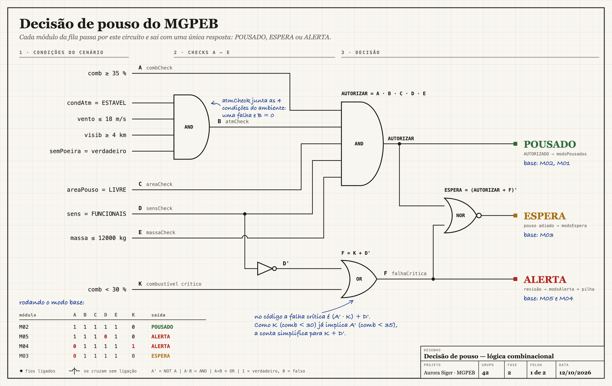
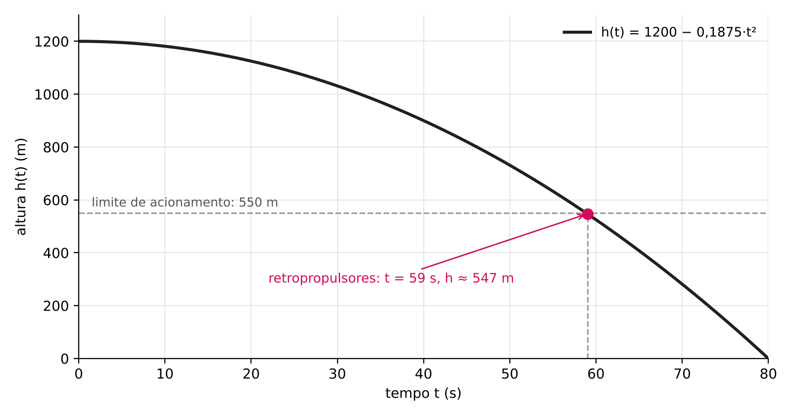
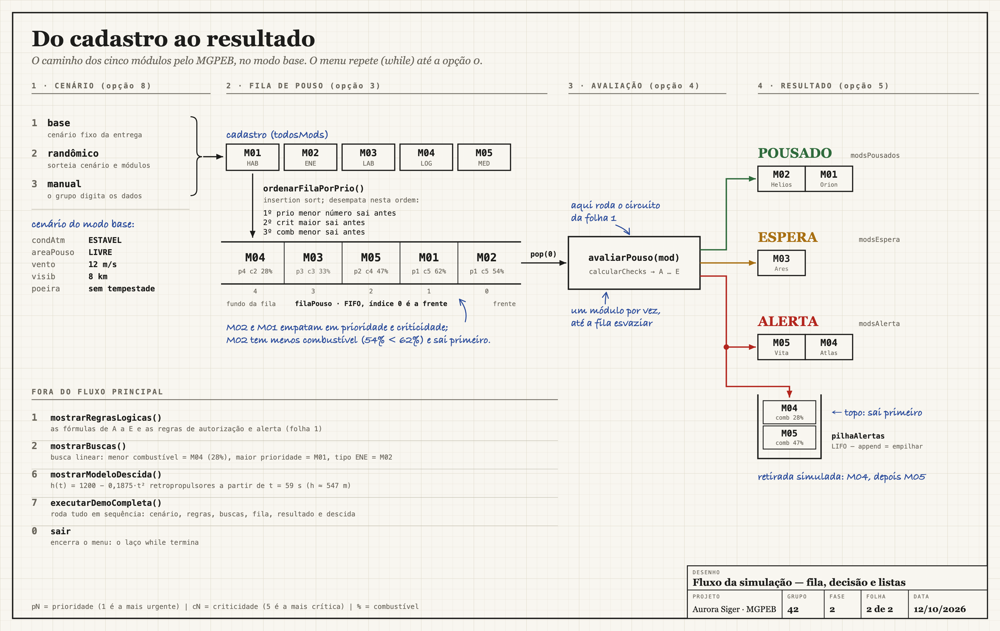

# Relatório Técnico — MGPEB

Módulo de Gerenciamento de Pouso e Estabilização de Base · Nave Aurora Siger · Fase 2 · Grupo 42

Integrantes: Ronei Davi Lach, Gabriel Hampel Meireles, Roberto Kenji Iuvata, José Roberto Zendron e David Silva

Repositório: https://github.com/rdlach/fiap-fase2-projeto-aurora-siger

## 1. Introdução e cenário de pouso

Na Fase 1, o desafio era decidir se a Aurora Siger podia decolar. Agora a nave já chegou à órbita de Marte e precisa soltar os módulos que vão formar a base da colônia. Como a comunicação com a Terra tem atraso, ninguém consegue controlar esses pousos em tempo real. Por isso criamos o MGPEB (Módulo de Gerenciamento de Pouso e Estabilização de Base), um protótipo em Python que coloca os módulos em fila, aplica as regras de autorização e classifica cada um como POUSADO, ESPERA ou ALERTA.

Usamos cinco módulos, cada um com os atributos pedidos no enunciado: prioridade de pouso (1 é a mais urgente), combustível, massa, criticidade da carga (5 é a mais crítica) e horário de chegada à órbita. A tabela abaixo traz os valores do modo base, que é o cenário fixo da demonstração.

| Módulo | Carga | Prioridade | Combustível | Massa | Criticidade | Órbita | Sensores |
| --- | --- | --- | --- | --- | --- | --- | --- |
| M01 Habitat Orion | Habitação | 1 | 62% | 9.200 kg | 5 | 08:10 | Funcionais |
| M02 Gerador Helios | Energia | 1 | 54% | 8.700 kg | 5 | 08:18 | Funcionais |
| M03 Lab Ares | Ciência | 3 | 33% | 7.600 kg | 3 | 08:24 | Funcionais |
| M04 Carga Atlas | Logística | 4 | 28% | 10.800 kg | 2 | 08:32 | Funcionais |
| M05 Suporte Vita | Médica | 2 | 47% | 6.900 kg | 4 | 08:40 | Falha parcial |

O cenário também inclui as condições de Marte na hora do pouso. No modo base, a atmosfera está estável, o vento está em 12 m/s, a visibilidade é de 8 km, não há tempestade de poeira e a área de pouso está livre. Além do modo base, o programa tem o modo randômico, que sorteia os valores para testar as regras em situações diferentes, e o modo manual, em que o usuário digita os dados.

## 2. Regras de decisão e portas lógicas

Cada módulo passa por cinco verificações booleanas, calculadas na função `calcularChecks`. Há ainda uma condição crítica, K, que só entra na regra de alerta.

| Variável | Nome no código | Verdadeira quando |
| --- | --- | --- |
| A | combCheck | combustível ≥ 35% |
| B | `atmCheck` | atmosfera estável, vento ≤ 18 m/s, visibilidade ≥ 4 km e sem tempestade de poeira |
| C | `areaCheck` | área de pouso livre |
| D | sensCheck | sensores funcionais |
| E | massaCheck | massa ≤ 12.000 kg |
| K | (falha crítica) | combustível < 30% |

Com essas variáveis, montamos três funções booleanas:

```
AUTORIZAR = A · B · C · D · E
ALERTA    = (A' · K) + D'   =   K + D'
ESPERA    = (AUTORIZAR + ALERTA)'
```

A autorização é uma porta AND de cinco entradas, então basta uma condição falsa para o pouso não ser liberado. A própria verificação atmosférica B também é um AND, das quatro condições do ambiente. Na regra de alerta, percebemos que o termo A' era desnecessário: se o combustível está abaixo de 30% (K), ele também está abaixo de 35% (A'). Com isso, ALERTA ficou K + D', ou seja, combustível crítico ou sensores com falha. A espera sai de uma porta NOR, que vale 1 quando o módulo não foi autorizado e também não está em alerta.

As três saídas nunca acontecem juntas. Se AUTORIZAR = 1, então A = 1 e D = 1, o que faz K = 0 e D' = 0, e portanto ALERTA = 0. E ESPERA só vale 1 quando as outras duas valem 0. Assim, cada módulo recebe uma única classificação. O circuito completo, com os casos do modo base, está na Figura 1.



| Caso | A | B | C | D | E | K | Saída |
| --- | --- | --- | --- | --- | --- | --- | --- |
| M02 e M01 (modo base) | 1 | 1 | 1 | 1 | 1 | 0 | POUSADO |
| M05 (modo base) | 1 | 1 | 1 | 0 | 1 | 0 | ALERTA |
| M04 (modo base) | 0 | 1 | 1 | 1 | 1 | 1 | ALERTA |
| M03 (modo base) | 0 | 1 | 1 | 1 | 1 | 0 | ESPERA |

O modo base passa pelas três saídas. M03 e M04 ajudam a ver a diferença entre ESPERA e ALERTA. Os dois falham em A, mas o M03 tem 33% de combustível, abaixo do mínimo de 35% e acima do nível crítico de 30% (K = 0), então fica esperando. O M04 tem 28%, abaixo do nível crítico (K = 1), e vai para revisão.

## 3. Protótipo em Python

O código está em `aurora_siger_pt2.py`, na pasta `projeto2-grupo`. Para rodar, a partir da pasta raiz do repositório, usamos `python projeto2-grupo/aurora_siger_pt2.py` (no Windows também funciona `py`; no macOS e no Linux, `python3`). O programa só usa recursos básicos do Python e o módulo `random`, para o modo randômico. O menu fica em um laço while até a opção 0 e tem as opções: regras lógicas (1), buscas (2), reiniciar e carregar a fila ordenada (3), processar a fila (4), resumo final (5), modelo matemático (6), reiniciar e rodar a demonstração completa (7), escolher o modo de dados e reiniciar (8) e reavaliar os pendentes (9).

### 3.1 Cadastro e estruturas lineares

Cada módulo é um dicionário com seus atributos. Quando a simulação começa, os cinco módulos são copiados para a fila principal, filaPouso, que funciona como FIFO. Depois de avaliado, cada módulo vai para uma de três listas (modsPousados, modsEspera ou modsAlerta), e os alertas também são guardados em uma pilha LIFO, a pilhaAlertas. O uso de cada estrutura está detalhado no Anexo A.

### 3.2 Ordenação da fila

A fila é ordenada pela função `ordenarFilaPorPrio`, que usa insertion sort (ordenação por inserção). A comparação fica na função `vemDepois` e segue três critérios: primeiro o menor número de prioridade; se empatar, a maior criticidade; se ainda empatar, o menor combustível. Esse último critério vem da ideia de pousar antes quem tem menos reserva. No modo base, M01 e M02 empatam em prioridade e criticidade, e o M02 desce antes por ter menos combustível (54% contra 62%). A fila fica M02, M01, M05, M03, M04.

Escolhemos o insertion sort porque ele é simples, ordena deslocando os elementos dentro da própria lista e funciona bem com listas pequenas ou quase ordenadas. A função trabalha em uma cópia da fila, para não mexer no cadastro original. No pior caso ele é O(n²), o que não pesa com cinco módulos. Com uma frota muito maior, valeria trocar por um algoritmo O(n log n), como merge sort ou heap sort.

### 3.3 Buscas

As três buscas são lineares: percorrem a lista do começo ao fim, com complexidade O(n), e não precisam que os dados estejam ordenados. No modo base, os resultados são:

| Função | Busca | Resultado |
| --- | --- | --- |
| buscarMenorComb | módulo com menor combustível | M04 Carga Atlas (28%) |
| buscarMaiorPrio | módulo mais urgente (desempate pela criticidade e, depois, pelo menor combustível) | M02 Gerador Helios |
| buscarPorTipo | todos os módulos de um tipo (ENE) | M02 Gerador Helios |

A busca de maior prioridade usa a mesma comparação da fila (`vemDepois`), por isso as duas apontam o M02. Não usamos busca binária, que é O(log n), porque ela exigiria manter a lista ordenada pelo atributo buscado, e com cinco módulos não faria diferença.

### 3.4 Decisão de pouso

A função `avaliarPouso` transforma as funções booleanas da Seção 2 em um if, elif e else, na mesma ordem do circuito:

```
if autPouso:
    return "AUTORIZADO", ...
elif falhaCritica:      # (not A and comb < 30) or not D
    return "ALERTA", ...
else:
    return "ESPERA", ...
```

A função `processarFila` tira um módulo por vez da frente da fila, aplica a decisão e manda o módulo para a lista certa, até a fila esvaziar. Este é um trecho da demonstração completa (opção 7) no modo base:

```
Analisando M05 - Suporte Vita
checks: comb=True atm=True area=True sens=False massa=True
Decisao: ALERTA OPERACIONAL
Motivo: Sensores com falha: FALHA PARCIAL.

Analisando M03 - Lab Ares
checks: comb=False atm=True area=True sens=True massa=True
Decisao: MODULO EM ESPERA
Motivo: Pouso adiado ate normalizacao das condicoes.

Analisando M04 - Carga Atlas
checks: comb=False atm=True area=True sens=True massa=True
Decisao: ALERTA OPERACIONAL
Motivo: Combustivel critico: 28%, abaixo de 30%.
```

No fim do modo base, M02 e M01 pousam, M03 fica em espera (combustível abaixo do mínimo, mas não crítico) e M05 (sensores) e M04 (combustível crítico) ficam em alerta.

### 3.5 Reavaliação e histórico

A opção 9 serve para continuar a operação depois do primeiro processamento. Nela dá para atualizar o ambiente e ajustar os dados dos módulos pendentes. Os módulos em espera voltam para a fila, e os em alerta só voltam se alguém confirmar que a revisão foi feita. Mesmo assim, o pouso não é liberado direto: o módulo passa por todas as verificações de novo. A função `ordenarFilaAtual` reordena a fila sem recarregar o cadastro, e `devolverPendente` confere o ID para o mesmo módulo não entrar duas vezes na fila. Quem já pousou continua na lista de pousados.

A mensagem de alerta agora mostra a causa: combustível crítico (com o valor e o limite de 30%), falha nos sensores ou as duas coisas. A mesma mensagem aparece na tela e na pilha. A lista modsAlerta tem os módulos que ainda estão retidos, e a pilhaAlertas guarda o histórico, inclusive de módulos que depois foram liberados. Se um módulo falhar de novo, entra outro registro na pilha. Autorizações, esperas e ajustes manuais não vão para a pilha, e o horário guardado é o de chegada à órbita, e não o do alerta.

As opções 3 e 7 limpam a fila, os resultados e o histórico e recarregam o cadastro do cenário escolhido. A opção 8 troca de cenário e também reinicia; para voltar aos valores base, é só usar 8 e depois 1. Os dados ficam só na memória e se perdem quando o programa fecha. As buscas da opção 2 olham o cadastro inicial (`todosMods`), e o resumo da opção 5 mostra a situação atual da operação. Por isso, um ajuste feito na opção 9 não aparece nas buscas.

### 3.6 Testes realizados

Testamos as regras em Python 3.14 com 2.160 combinações: combustível de 29, 30, 34, 35 e 36%; atmosfera, área e sensores nas duas situações; massas de 11.999, 12.000 e 12.001 kg; vento de 17, 18 e 19 m/s; visibilidade de 3, 4 e 5 km; com e sem poeira. Todas deram a classificação esperada. Também rodamos 100 cenários aleatórios para conferir a classificação, a ordenação e se a busca de maior prioridade bate com a fila. Foram testes feitos por nós, para o protótipo, e não ficaram como testes automáticos no projeto.

| Caso testado | Resultado |
| --- | --- |
| Modo base, opção 7 | Pousados M02 e M01; espera M03; alertas M05 e M04 |
| Opção 9 sem alterar dados nem liberar alertas | M03 continua em espera; pousados e histórico mantidos |
| M03 ajustado para 40%, resto no modo base | M03 pousa; M02 e M01 continuam pousados |
| Alerta revisado, mas sensores ainda com falha | Novo alerta, sem autorização indevida |
| Área ocupada e depois liberada | Espera e, depois, pouso só dos módulos seguros |
| Combustível 28% e sensores com falha juntos | Motivo mostra as duas causas, também na pilha |
| Busca de tipo que não existe e listas vazias | Lista vazia ou None, sem erro |
| Descida em 0, 59 e 80 segundos | 1.200 m, 547,31 m e 0 m; sugestão em 59 s |

Também passamos pelos modos base, manual e randômico, por entradas numéricas inválidas, pela confirmação S/N da opção 9, por tentativas de processar a fila duas vezes e por um cenário em que todos pousam. Nos testes da reavaliação, nenhum módulo apareceu repetido entre fila, pousados, espera e alerta.

### 3.7 Hipóteses e limitações

Consideramos que os cinco módulos já estão em órbita e disponíveis; os horários servem só como informação. A simulação não tem um relógio andando e não gasta combustível enquanto o módulo espera. O ambiente fica igual durante cada processamento e só muda se for atualizado na opção 9. A área também não fica ocupada depois de um pouso: se está livre, vale para todos os módulos daquela rodada. E, quando o pouso é autorizado, consideramos que deu certo e o status já vira POUSADO.

Mudar o combustível na opção 9 é trocar um dado do cenário, e não reabastecer o módulo. O M03, com 33%, não sai da espera só esperando. O cadastro tem sempre cinco módulos, e a busca por tipo do menu procura ENE. No modo manual (opção 8), é preciso digitar ESTAVEL, LIVRE e S/N como o programa pede, porque qualquer outro texto vira condição desfavorável, sem perguntar de novo. A opção 9 já repete a pergunta quando a resposta não é S ou N; levar isso para o modo manual ficou como melhoria.

## 4. Modelagem matemática da descida

Para ajudar a decidir quando acionar os retropropulsores, representamos a altura do módulo durante a aproximação com uma função quadrática:

```
h(t) = h0 − a · t²     com  a = h0 / T²
```

Os parâmetros ficam no início do código: h0 = 1.200 m (altura inicial da aproximação) e T = 80 s (tempo até a altura chegar a zero), o que dá a = 1.200 / 80² = 0,1875 m/s². O tempo t está em segundos e h(t) em metros, e analisamos o intervalo de 0 a 80 s. A função `mostrarModeloDescida` mostra h(t) a cada 20 s e procura o primeiro segundo em que a altura fica abaixo de 550 m (`altRetroM`).



| t (s) | 0 | 20 | 40 | 59 | 60 | 80 |
| --- | --- | --- | --- | --- | --- | --- |
| h(t) (m) | 1.200,00 | 1.125,00 | 900,00 | 547,31 | 525,00 | 0,00 |

**Análise qualitativa.** O gráfico é um pedaço de parábola com concavidade para baixo e vértice em t = 0, onde a altura é máxima. No começo a curva é quase horizontal e vai ficando mais inclinada, porque o módulo desce cada vez mais rápido. A velocidade vertical é h'(t) = −2a·t, negativa porque a altura está diminuindo. Em módulo, |v(t)| = 2a·t, o que dá 7,5 m/s em t = 20 s, cerca de 22 m/s em t = 59 s e 30 m/s em t = 80 s. Resolvendo h(t) = 550, chegamos a t = T·√(1 − 550/h0) ≈ 58,9 s, e o programa sugere acionar os retropropulsores em t = 59 s, a 547,31 m.

**Efeito dos parâmetros.** Se T aumenta (descida mais longa), a diminui, a curva fica mais suave e o acionamento acontece mais tarde; se T diminui, acontece o contrário. Se h0 aumenta e T continua igual, a aumenta: o módulo cruza os 550 m mais tarde, porém mais rápido; com h0 menor, o cruzamento vem antes. Subir o limite de 550 m adianta o acionamento e dá mais margem de segurança, mas gasta mais combustível na frenagem.

**Limites do modelo.** A função representa só a queda antes da frenagem. Nessa fase a velocidade só aumenta, e o módulo chegaria ao chão a 30 m/s se nada fosse feito. Por isso o que interessa no modelo não é o momento do contato com o solo, e sim o momento da decisão: ele indica quando os retropropulsores precisam entrar. O que acontece depois do acionamento não foi modelado. A sugestão aparece na opção 6 e na demonstração, mas não aciona nenhum equipamento nem interfere na classificação feita em processarFila. Juntar a descida e a frenagem ao processamento fica como próximo passo.

## 5. Contexto histórico e arquitetura

Por trás do MGPEB está uma ideia antiga da computação: chaves que ligam e desligam, combinadas para resolver problemas de lógica e de aritmética. As portas AND, OR, NOT e NOR da Figura 1 são isso. O que foi mudando com o tempo foi o tipo de chave: engrenagens nas calculadoras mecânicas, relés nos primeiros computadores eletromecânicos, válvulas na primeira geração, transistores na segunda e circuitos integrados a partir da terceira, cada vez mais integrados (LSI, VLSI e ULSI).

A máquina analítica de Charles Babbage, de 1837, já tinha três ideias que aparecem no nosso protótipo: entrada de dados (aqui, os modos base, randômico e manual), memória para guardar valores (as listas e a pilha) e execução de operações em sequência (o menu e o processamento da fila). Nos computadores de relés de Konrad Zuse, a soma binária já era feita com as mesmas portas que usamos: o bit da soma é um XOR e o "vai um" é um AND. Os primeiros computadores de uso geral, como o ENIAC, com cerca de 30 toneladas e 17.840 válvulas, ocupavam salas inteiras. Com a miniaturização dos componentes, hoje é possível colocar um computador dentro de equipamentos pequenos. A Lei de Moore descreve essa tendência de o número de transistores por circuito aumentar com o tempo, mas não diz nada sobre confiabilidade.

Um sistema embarcado em Marte tem limitações que um computador comum não tem: pouca memória e processamento, energia dividida com o suporte à vida, radiação e nenhuma chance de manutenção rápida. Isso pesou nas escolhas do protótipo:

- estruturas lineares simples (listas, fila e pilha), sem bibliotecas externas;
- algoritmos simples e de custo previsível (busca linear e insertion sort), que bastam para uma frota pequena;
- regras booleanas explícitas, fáceis de conferir e testar, o que importa muito quando não dá para corrigir um erro a distância;
- registro dos alertas em pilha, para a revisão começar pelo problema mais recente.

Por ser um trabalho acadêmico, o protótipo não trata radiação, não tem redundância e não passou por certificação de controle de voo. Ele também faz cópias dos módulos para preservar o cadastro original, o que gasta memória extra; em um sistema embarcado de verdade, essa escolha teria de ser revista.

## 6. Governança ambiental, social e corporativa na base Aurora Siger

### Introdução

Com o pouso dos módulos, a missão deixa de ser "chegar a Marte" e passa a ser "viver em Marte". A partir daí, as decisões da colônia não são mais só técnicas: elas afetam um ambiente que ainda não foi tocado, as pessoas que vão morar e trabalhar ali e a confiança em quem decide. Por isso usamos como base os princípios ESG (*Environmental, Social and Governance*) e a definição de desenvolvimento sustentável do Relatório Brundtland: atender às necessidades do presente sem comprometer as das gerações futuras. Em Marte, essas gerações futuras são os próximos colonos e também a ciência, que precisa de um planeta preservado para estudar.

### Critérios para a escolha da área de pouso

Para escolher a área de pouso, seguimos a abordagem preventiva do princípio 7 do Pacto Global: quando não se sabe bem qual será o impacto, é melhor evitar o dano do que tentar consertar depois. Além da segurança do pouso, propomos quatro critérios: (1) evitar regiões de grande interesse científico, para que continuem disponíveis para pesquisa; (2) dar preferência a áreas perto de recursos úteis, como gelo e boa incidência de sol, para gastar menos energia com deslocamento; (3) concentrar os pousos em uma área delimitada, para alterar menos o solo; e (4) registrar como a área era antes da ocupação, para poder comparar depois. O código hoje confere se a área está livre (`areaCheck`) e se o clima permite o pouso (`atmCheck`), que são critérios de segurança. A escolha da área pelo impacto ambiental, pelo valor científico e pelos recursos fica como proposta de governança, ainda fora do código.

### Gestão sustentável de energia, resíduos e recursos locais

Em Marte, quase todos os recursos são escassos e, na escala de tempo da colônia, não se renovam. Por isso baseamos a proposta em três Objetivos de Desenvolvimento Sustentável da Agenda 2030. Na energia (ODS 7), a base deve dar prioridade à geração solar e à eficiência, ligando primeiro o suporte à vida; não é coincidência que o módulo de energia esteja entre os primeiros da fila de pouso. Na água (ODS 6), o gelo extraído precisa ser tratado como recurso de todos, com controle do consumo e reaproveitamento em circuito fechado. Nos resíduos e na produção (ODS 12), a ideia é a da economia circular: consertar, reutilizar e reciclar antes de descartar, já que não chega reposição rápida da Terra. Para isso funcionar, é preciso acompanhar indicadores, como energia gerada e consumida, água reaproveitada e resíduos reciclados. Chamar a base de sustentável sem medir nada seria *greenwashing*.

### Governança, transparência e participação

Uma colônia isolada concentra o poder em poucas pessoas e em sistemas automáticos, e por isso as regras precisam ser claras. Propomos: (1) decisões automáticas com regras públicas, como as expressões booleanas do MGPEB, que qualquer colono pode ler e conferir; (2) registro de todas as ocorrências, como meta para o futuro, já que hoje a pilha guarda só os alertas, com o módulo, a causa, o combustível e o horário de chegada à órbita (a opção 9 mantém esse histórico, mas ele se perde ao reiniciar ou fechar o programa, e ainda não há registro das demais decisões, de quem decidiu nem do horário de cada evento); (3) relatórios periódicos de desempenho ambiental e social, no modelo da Global Reporting Initiative (GRI); (4) um conselho com representantes das diferentes funções da base, para que o uso dos recursos seja discutido e não apenas imposto; e (5) condições de trabalho seguras, jornadas justas e combate à corrupção, de acordo com os princípios de trabalho e o princípio 10 do Pacto Global. No fim, a responsabilidade continua sendo humana: o sistema recomenda, mas quem responde pelas decisões são as pessoas.

### Conclusão

As diretrizes ESG completam a simulação de pouso e servem de ponto de partida para a governança da colônia. Juntando as três dimensões, buscamos o equilíbrio do *triple bottom line* (pessoas, planeta e resultado): uma base que funcione tecnicamente, proteja as pessoas, use os recursos com cuidado e tome decisões de forma transparente. Marte vai precisar de uma governança local que respeite os acordos internacionais. Esses princípios funcionam como um compromisso voluntário, parecido com o do Pacto Global entre as empresas, e devem valer desde o primeiro pouso.

## 7. Conclusão

O MGPEB juntou os conteúdos da Fase 2 em um único problema. As portas lógicas definem as regras de decisão, o Python executa essas regras com condicionais e laços, as estruturas lineares organizam o caminho dos módulos, a busca e a ordenação definem quem pousa primeiro e a função quadrática indica a hora de acionar os retropropulsores. A história da computação ajuda a entender os limites do hardware embarcado, e os princípios ESG orientam o uso da tecnologia e dos recursos de Marte.

No modo base, dois módulos pousaram, um ficou em espera e dois ficaram em alerta por motivos diferentes (sensores com falha e combustível crítico). A comparação entre o M03, que espera com 33% de combustível, e o M04, que vai para revisão com 28%, mostra que as regras separam um problema grave de uma espera simples. Como próximos passos, vemos dois: modelar a frenagem depois do acionamento dos retropropulsores e trocar a lista da fila por uma estrutura que retire o primeiro elemento em tempo constante, caso a frota cresça.

## Anexo A – Estruturas de dados utilizadas



| Estrutura | Variável | Tipo | Operações usadas | Papel na simulação |
| --- | --- | --- | --- | --- |
| Fila principal | filaPouso | Fila (FIFO) sobre list | append para inserir; `pop(0)` para retirar da frente | módulos esperando avaliação, na ordem de prioridade |
| Lista de pousados | modsPousados | Lista | append | módulos com pouso autorizado |
| Lista de espera | modsEspera | Lista | append | módulos com pouso adiado |
| Lista de alerta | modsAlerta | Lista | append | módulos que precisam de revisão |
| Pilha de alertas | pilhaAlertas | Pilha (LIFO) sobre list | append para empilhar; pop para desempilhar | histórico de alertas; o mais recente é revisado primeiro |
| Cadastro | todosMods | Lista de dicionários | percurso com for | base para as buscas e para carregar a fila |

**Fila (FIFO).** A função `carregarFila` coloca os cinco módulos na fila com append, e `prepararFilaOrdenada` troca o conteúdo pela versão ordenada: M02, M01, M05, M03, M04. Em `processarFila`, o laço while `len(filaPouso) > 0` chama `filaPouso.pop(0)`, que sempre tira o módulo da frente, como o dequeue de uma fila. Assim, o primeiro a sair é o M02 e o último é o M04. Em uma lista do Python, `pop(0)` custa O(n), porque os outros elementos andam uma posição. Com cinco módulos isso não faz diferença; com uma frota grande, `collections.deque` faria a mesma coisa em O(1).

**Listas auxiliares.** Depois da decisão, cada módulo vai para uma única lista. No modo base, ficam modsPousados = [M02, M01], modsEspera = [M03] e modsAlerta = [M05, M04]. Com essas listas, o resumo final (opção 5) é montado sem processar a fila de novo.

**Reavaliação.** Depois da opção 7, a fila está vazia, os pousados são [M02, M01], a espera é [M03] e os alertas são [M05, M04]. Se, na opção 9, mantivermos o ambiente, mudarmos só o combustível do M03 para 40% e não confirmarmos a revisão dos alertas, o resultado é pousados = [M02, M01, M03], espera = [] e alertas = [M05, M04]. Os dois registros que já estavam na pilha continuam lá.

**Pilha (LIFO).** A função `registrarAlerta` empilha, com append, um registro com id, nome, motivo, combustível e horário de órbita. No modo base, o M05 é empilhado primeiro e o M04 depois, ficando no topo. Para mostrar a pilha sem apagá-la, `mostrarPilhaAlertas` copia os itens para uma pilha temporária e desempilha essa cópia com pop. Por isso a tela mostra primeiro o M04 e depois o M05, e a pilha original continua inteira. A pilha é um histórico: um alerta que aparece nela pode já ter sido resolvido. Os alertas ainda pendentes ficam em modsAlerta.
